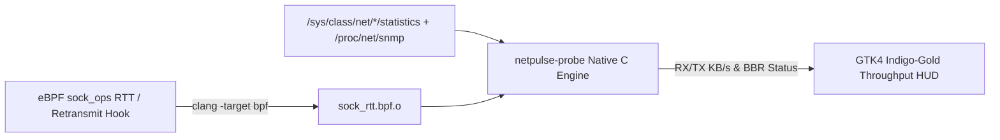

# NetPulse BPF

[](LICENSE)
[](#architecture)
[](#gallery)
[](https://github.com/lwrlock/ff-power-manager)

**Real-time Linux TCP BBR / `fq` qdisc congestion telemetry, `/proc/net/snmp` retransmit analytics, per-process socket descriptor profiling, and eBPF `sock_ops` RTT hooks in C and Python/GTK4.**

<p align="center">
  
</p>

## Architecture



## Highlights

- **eBPF `sock_ops` RTT Hook:** Compiles `bpf/sock_rtt.bpf.c` directly to eBPF ELF bytecode tracking smoothed RTT and retransmit callbacks.
- **TCP BBR & Qdisc Verification:** Reads kernel `tcp_congestion_control`, `default_qdisc`, SNMP retransmit ratios, and active interface RX/TX rates.
- **Process Socket Blame:** Ranks processes by active `socket:[*]` file descriptors cleanly without exposing private IPs.

<details>
<summary><b>Full-Resolution UI Screenshot</b></summary>

<p align="center">
  
</p>

</details>

## Build & Run

```bash
make test
./netpulse-probe --json
PYTHONPATH=src /usr/bin/python3 -m netpulse.gui
```

---

### FF Linux Kernel & Systems Suite
[FF Power Manager](https://github.com/lwrlock/ff-power-manager) · [eBPF Latency Guard](https://github.com/lwrlock/ebpf-latency-guard) · [VRAM Atlas](https://github.com/lwrlock/vram-atlas) · [Waylens Privacy](https://github.com/lwrlock/waylens-privacy) · [MemPulse](https://github.com/lwrlock/mempulse) · **NetPulse BPF** · [NVMe Sentinel](https://github.com/lwrlock/nvme-sentinel)

MIT License — Copyright (c) 2026 Furkan (**lwrlock**). Built with assistance from Google DeepMind Antigravity.
