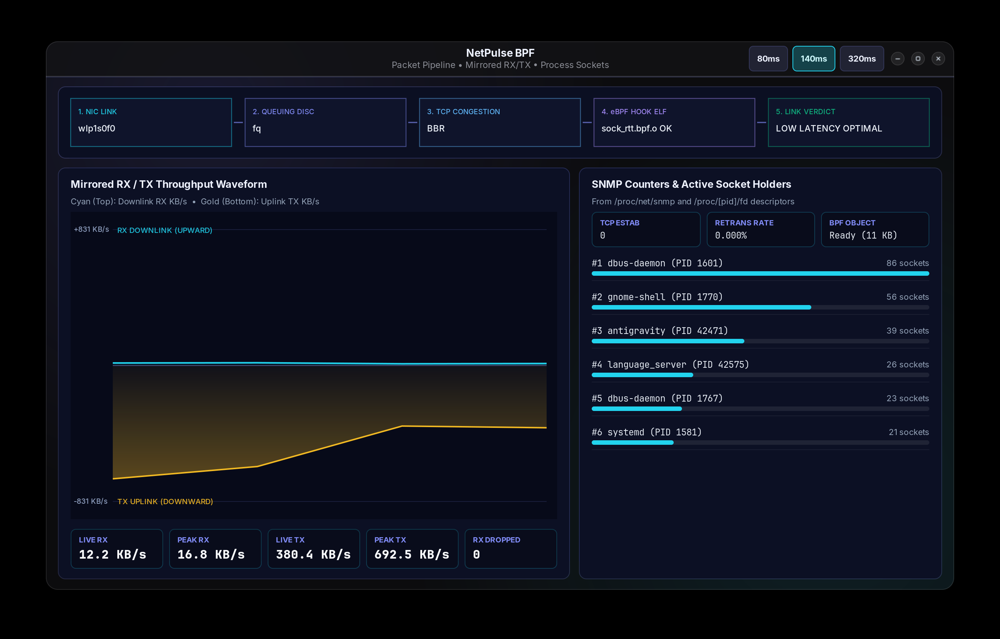

# netpulse-bpf

Linux interface throughput, TCP congestion settings, and process socket monitor in C, eBPF, and Python/GTK4.



## How it works

- **`netpulse-probe` (`src/native/net_probe.c`):** Runs unprivileged in C, sampling `/sys/class/net/<iface>/statistics/{rx_bytes,tx_bytes,rx_dropped}` over `--sample-ms`, reading `tcp_congestion_control` and `default_qdisc`, parsing TCP segment/retransmit counters from `/proc/net/snmp`, and counting `socket:[*]` file descriptors per PID.
- **`bpf/sock_rtt.bpf.c`:** Compiled with `clang -target bpf` to `bpf/sock_rtt.bpf.o`, defining a `sock_ops` hook (`BPF_SOCK_OPS_RTT_CB`, `BPF_SOCK_OPS_RETRANS_CB`) that records RTT sums and retransmit counts into a BPF array map.
- **`src/netpulse/`:** Evaluates link state (`LOW_LATENCY_OPTIMAL`, `ELEVATED_RETRANS`, `CONGESTED`) and renders the GTK4/Cairo graphs.

## Build & Run

```bash
make all
make test
./netpulse-probe --sample-ms 80 --json
PYTHONPATH=src /usr/bin/python3 -m netpulse.gui
```

## Related

[ff-power-manager](https://github.com/lwrlock/ff-power-manager) · [ebpf-latency-guard](https://github.com/lwrlock/ebpf-latency-guard) · [vram-atlas](https://github.com/lwrlock/vram-atlas) · [waylens-privacy](https://github.com/lwrlock/waylens-privacy) · [mempulse](https://github.com/lwrlock/mempulse) · [nvme-sentinel](https://github.com/lwrlock/nvme-sentinel)

## License

MIT — see [LICENSE](LICENSE).
